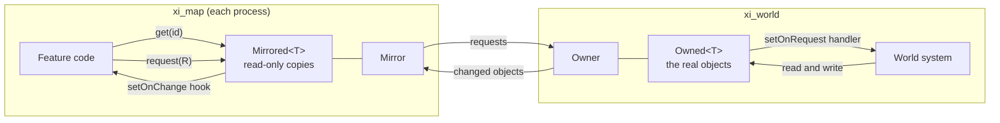
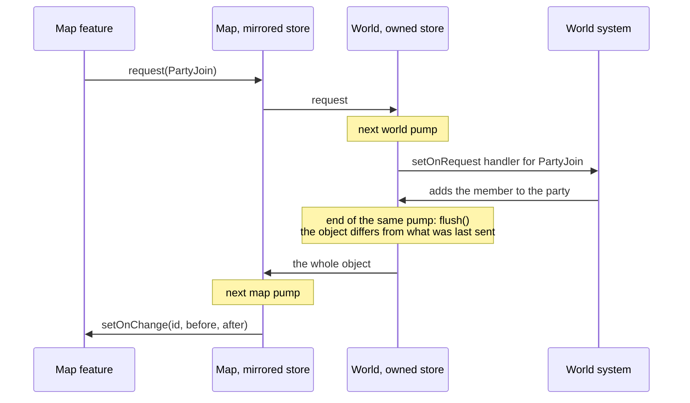
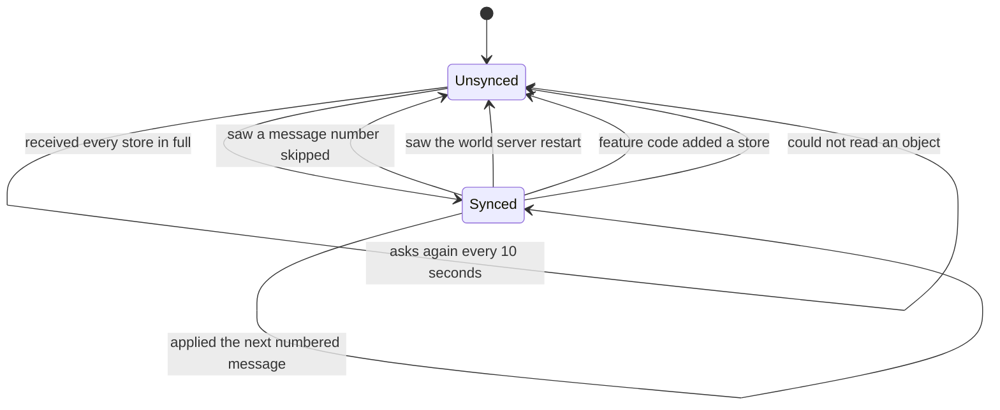
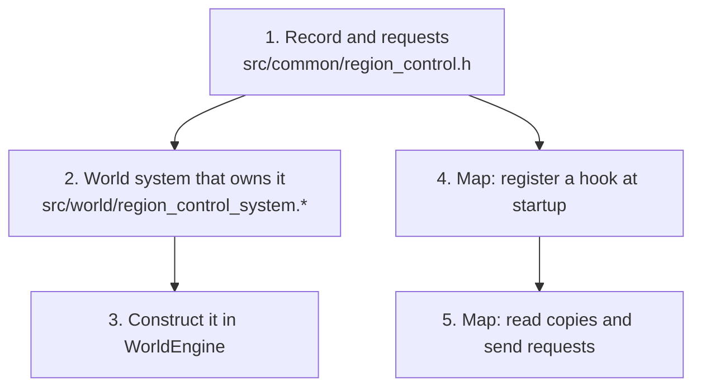

# Replicated State

`xi::replica` keeps a set of objects on the world server and gives every map server a read-only copy of them. The world server is the only place they change. A map server that wants one changed asks, and sees the result arrive in its copy.

Use it for state that several map servers read and must agree on, such as who is in a party. The code is in [`src/common/replica`](https://github.com/LandSandBoat/server/tree/base/src/common/replica).

## When to use it

Use it when all of these are true:

- More than one map server needs the data.
- The data is read far more often than it changes.
- A map server can afford to see a change a fraction of a second late.

Do not use it for these:

- **Notifications.** "A player sent a tell" is an event. Send a regular IPC message.
- **Things that change every tick.** HP, position and enmity stay on the map server that owns the entity.
- **Large objects that change a little at a time.** The owner sends a changed object whole. Split it into smaller objects first.

## Concepts



| Name | Where | What it is |
| --- | --- | --- |
| `Owner` | world | Holds every store and streams their changes. One per world server, reached with `IPCServer::replica()`. |
| `Owned<T>` | world | The objects of one type. A plain container: read and write the objects directly. |
| `Mirror` | map | Receives what the owner streams. One per map server. Feature code does not use it directly. |
| `Mirrored<T>` | map | Read-only copies of the objects of one type, reached with `mirrored<T>()`. |
| Request | map to world | A small struct asking the world server to do something. |
| Audience | world | Which map servers receive an object. Every map server unless the store says otherwise. |

Both sides create the store on first use and return the same one afterwards:

```cpp
auto& parties = owner.store<xi::Party>(); // world: Owned<xi::Party>&
auto& parties = mirrored<xi::Party>();    // map:   Mirrored<xi::Party>&
```

### How a change travels

Writing to an object sends nothing. Once per IPC pump, every 100 ms, the owner compares each object with the copy it last sent. It sends each object that differs, whole, to the map servers in that object's audience. For an erased object it sends a removal.



Two consequences:

- **Several writes in one pump arrive as one change.** A map server never sees the values in between.
- **A request has no reply.** The answer to a request is the object changing. If the world server refuses, nothing happens on the map server.

### Staying in sync

The owner numbers the messages it sends to each map server. A map server that sees a number skipped asks for everything again. Every 10 seconds it also asks the owner what the latest number is, which catches a lost final message.

When the world server restarts, it picks a new boot id. A map server that sees the id change also asks for everything again.

"Everything" is one message holding all the objects of every store the map server follows. The map server replaces its copies with it. It removes objects that are no longer present, and runs the change hook only for objects that differ. Feature code never notices a resync that changes nothing.



`Mirror::synced()` reports this state. While it is false, `request()` logs a warning and sends nothing.

## Adding a replicated type

The party code is the working example: [`party_data.h`](https://github.com/LandSandBoat/server/blob/base/src/common/party_data.h), [`party_system.cpp`](https://github.com/LandSandBoat/server/blob/base/src/world/party_system.cpp) and `party::init` in [`party.cpp`](https://github.com/LandSandBoat/server/blob/base/src/map/party.cpp).

The steps below build a trimmed-down conquest: which nation controls each region, and how much influence each nation has there. Map servers add influence when players fight, and every map server needs to know who controls a region. It is a sketch to show the shape. The real conquest system does much more.



### 1. Declare the record and its requests

Put both in one header under `src/common`. The world and map servers both include it.

```cpp
namespace xi
{

// who controls a region and where each nation stands in it, keyed by region id
struct RegionControl
{
    uint8                 owner{};     // nation
    std::array<uint32, 4> influence{}; // san d'oria, bastok, windurst, beastmen

    auto operator==(const RegionControl&) const -> bool = default;
};

// what a map server can ask the world server to do to a region

struct RegionAddInfluence
{
    uint64 region{};
    uint8  nation{};
    uint32 points{};
};

} // namespace xi
```

Rules for the record:

- A plain struct of fields the IPC serializer can already handle: numbers, strings, enums, standard containers, and other such structs.
- It needs `operator==`. The owner uses it to notice a change.
- The world server chooses a `uint64` id for every object. The struct does not hold the id.
- Keep it small. The owner sends all of it whenever any field changes.

Rules for requests:

- One struct per thing a map server can ask for. They do not need `operator==`.
- Put the id of the object in the request if it has one. A request to create something has no id yet.
- Ask for what should happen. The map server sends "add 20 points", never "influence is now 340". Two map servers adding at once would otherwise overwrite each other.

### 2. Write the world system

The world system holds the store, registers one handler per request, and changes the objects.

```cpp
class RegionControlSystem final
{
public:
    explicit RegionControlSystem(xi::replica::Owner& replica);

    // run from the weekly timer
    void tally();

private:
    xi::replica::Owned<xi::RegionControl>& regions_;
};
```

```cpp
RegionControlSystem::RegionControlSystem(xi::replica::Owner& replica)
: regions_(replica.store<xi::RegionControl>())
{
    regions_.setOnRequest<xi::RegionAddInfluence>(
        [this](const IPP& mirror, const xi::RegionAddInfluence& request)
        {
            auto* region = regions_.find(request.region);
            if (!region || request.nation >= region->influence.size())
            {
                return;
            }

            region->influence[request.nation] += request.points;
        });
}

void RegionControlSystem::tally()
{
    for (auto id = uint64{ 0 }; id < kRegionCount; ++id)
    {
        if (auto* region = regions_.find(id))
        {
            const auto leader = std::ranges::max_element(region->influence);
            region->owner     = static_cast<uint8>(leader - region->influence.begin());
        }
    }
}
```

There is no send call. Writing to `regions_` is enough: the flush at the end of the pump notices the difference and streams it.

`tally()` shows the other half: the world system can change objects on its own, here from a timer. The same rule applies. If the weekly tally leaves a region's owner unchanged, the owner sends nothing for that region.

A map server is a trusted process, but it built the request from what a player did a moment ago. On the world server, check anything that could have changed since, such as whether the region still exists.

### 3. Construct it in the world engine

Add the system to `WorldEngine`, after `ipcServer_`, and pass it the owner:

```cpp
, regionControlSystem_(std::make_unique<RegionControlSystem>(ipcServer_->replica()))
```

Construct it there, before the first pump. If a map server asks for a type that no world system owns yet, the world server answers that the type has no objects and logs a warning.

### 4. Register a hook on the map server

`mirrored<T>()`, from [`src/map/replica.h`](https://github.com/LandSandBoat/server/blob/base/src/map/replica.h), returns the map server's copies of a type.

Register the hook once at startup, from a function that `MapEngine::init` calls after `message::init`. A hook registered late misses the objects that arrive first.

```cpp
void regioncontrol::init()
{
    mirrored<xi::RegionControl>().setOnChange(
        [](const uint64 regionId, const xi::RegionControl* before, const xi::RegionControl* after)
        {
            if (!after)
            {
                return;
            }

            if (!before || before->owner != after->owner)
            {
                // the region changed hands: update its overseers and the players' latent effects
            }
        });
}
```

| `before` | `after` | Meaning |
| --- | --- | --- |
| null | set | The object is new to this map server. |
| set | set | The object changed. Compare the two to see what changed. |
| set | null | The object is gone. |

Things to know about the hook:

- It runs after the map server has applied the whole message. When two related objects change in the same pump, each hook can read the other object's new value.
- It reports differences in state. After a resync it runs for whatever differs, however long ago that changed, so do not hand out a reward from it.
- `after` and anything returned by `get()` point into the store. Do not keep them past the hook.

### 5. Read copies and send requests

Anywhere on the map server:

```cpp
if (const auto* region = mirrored<xi::RegionControl>().get(regionId))
{
    // read region->owner
}

mirrored<xi::RegionControl>().request(xi::RegionAddInfluence{ .region = regionId, .nation = nation, .points = 20 });
```

Do not change local state because you sent a request. Wait for the hook.

### Limiting who receives an object

By default every object goes to every map server, which is right for region control. To narrow it, give the store an audience on the world server:

```cpp
regions_.setAudience(
    [this](const uint64 regionId, const xi::RegionControl& region)
    {
        return mapsHostingRegion(regionId); // std::vector<IPP>
    });
```

The owner calls it for every object on every pump, so keep it cheap. The owner sends an object to a map server that joins its audience, and tells one that leaves to remove it.

## What is and is not guaranteed

| Guaranteed | Not guaranteed |
| --- | --- |
| Only the world server changes an object. | That a request arrives. The network can lose it, and the map server drops it while not synced. |
| A synced map server holds what the world server last sent it. | That a map server sees every intermediate value. |
| A map server notices a lost message and repairs it, within 10 seconds at worst. | That a request gets an answer. A refusal is silent. |
| A map server notices a world server restart and replaces its copies. | That objects survive a world server restart. The layer saves nothing. |

A system whose objects must survive a restart has to load them in its constructor and save them when it changes them.

Build the world and map servers from the same source. A hash of a type's name and field names identifies it on the wire. Rename a type or a field on one side only, and the other side sees a different type.

## Debugging

Set `DEBUG_REPLICA = true` in `settings/logging.lua`. One request then reads like this on the map server:

```
replica: request xi::PartyJoin on xi::Party
replica: 1 items from owner
replica: xi::Party 1 created
```

And on the world server:

```
replica: 127.0.0.1:54230 requests xi::PartyJoin on xi::Party
replica: put xi::Party 1 to 127.0.0.1:54230
replica: flush, 1 items to 127.0.0.1:54230
```

The servers log these lines whatever the setting:

| Line | Meaning |
| --- | --- |
| `owner epoch A -> B, syncing` | The map server saw a world server restart. |
| `X not sent, T is not synced with the owner` | Feature code sent a request before the first sync or during a repair. |
| `T has no handler for request N` | The world server has no `setOnRequest` for that request type. |
| `bad body for T id` | The map server could not read an object. Usually the servers were built from different source. |
| `follows type N, which nothing here owns` | A map server asked for a type no world system has created. |

## Testing

- Test a world system by constructing it with a bare `xi::replica::Owner` and calling it directly. See [`party_system_tests.cpp`](https://github.com/LandSandBoat/server/blob/base/src/test/tests/party_system_tests.cpp).
- The layer's own tests are in [`replica_tests.cpp`](https://github.com/LandSandBoat/server/blob/base/src/test/tests/replica_tests.cpp). Their `Rig` wires one owner to two mirrors through queues, which lets a test drop a message and check the repair.
